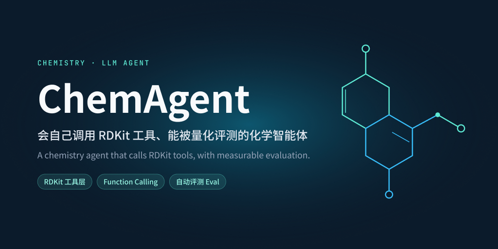
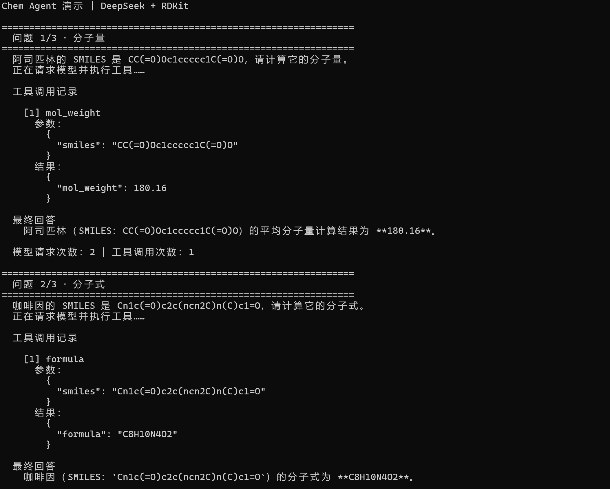
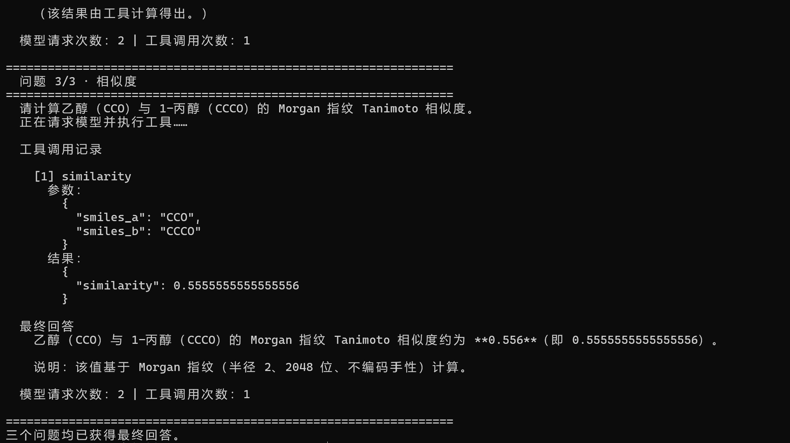
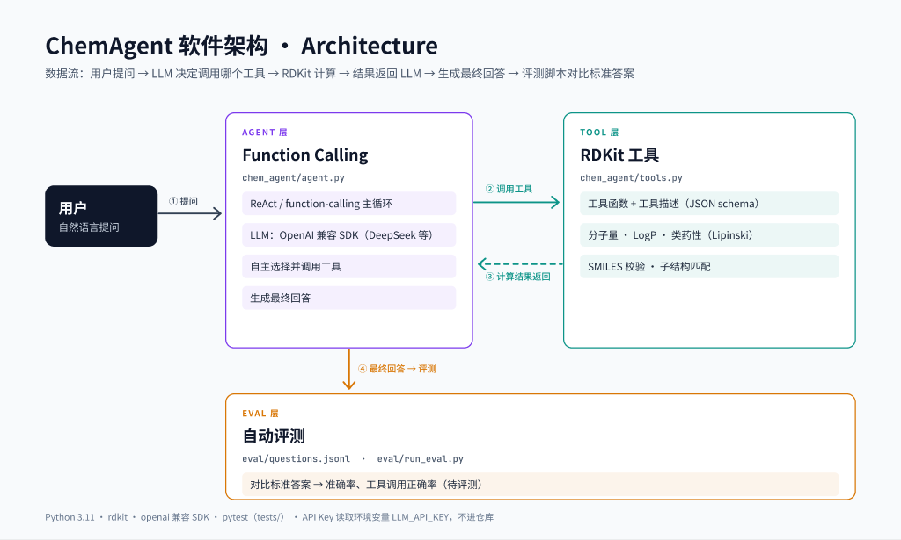

# Chem Agent · 化学工具助手



用 DeepSeek 选择工具、RDKit 计算分子性质与结构警示的中文化学助手，附带 v1（40 题）和 v2（60 题）评测及真实迭代记录。


[English](#english)

## 功能

| RDKit 工具 | 功能 |
| --- | --- |
| `mol_weight(smiles)` | 平均分子量，保留两位小数；数值对应摩尔质量 g/mol |
| `logp(smiles)` | Wildman–Crippen 预测 LogP |
| `formula(smiles)` | 分子式 |
| `tpsa(smiles)` | 拓扑极性表面积，单位 Ų |
| `hbd_hba(smiles)` | 氢键供体数和受体数 |
| `lipinski(smiles)` | Lipinski 指标、违反项数和筛选结果；当前实现允许最多违反一项 |
| `similarity(smiles_a, smiles_b)` | Morgan 指纹的 Tanimoto 相似度，半径 2、2048 位，不编码手性 |
| `safety_check(smiles)` | 使用 RDKit FilterCatalog 内置 Brenk（BRENK）与 NIH 规则，返回结构警示名称、目录、论文来源及免责声明 |

- **Function-calling Agent**：使用 OpenAI 兼容 SDK 手写循环，不依赖 LangChain；模型选工具，本地执行并回传结果，最终用中文回答。默认最多请求模型 5 次，保留每次工具调用的参数和结果。
- **两版题集**：v1 为 40 题；v2 保留这些题，新增安全检查 8 题、多步骤 6 题、易混淆 6 题，共 60 题。期望值由本地工具生成，支持有序多工具评分、按类别汇总、错题记录与 token 统计。
- **安全规则有出处**：只使用 RDKit 内置目录，不手写 SMARTS。Brenk et al., *ChemMedChem* (2008)，DOI [10.1002/cmdc.200700139](https://doi.org/10.1002/cmdc.200700139)；Jadhav et al., *J Med Chem* (2010)，DOI [10.1021/jm901070c](https://doi.org/10.1021/jm901070c)。完整论文名称见文末“规则来源”。
- **输入检查**：工具遇到非法 SMILES 返回 `error`；单道评测题异常记为失败并继续。
- **三题演示**：依次展示分子量、分子式和相似度问题的工具名称、参数、计算结果及最终回答。
- **MCP stdio 服务**：用官方 MCP Python SDK 的 FastMCP 暴露上述 8 个工具，复用原函数和 schema；附本地客户端与真实 stdio 协议测试，无需 `LLM_API_KEY`。

**安全免责声明：仅基于结构的规则粗筛（药物化学警示库），不是毒性或爆炸性评估，请以 MSDS/SDS 为准。** 无警示不等于安全。Agent 的 system prompt 要求转述免责声明，且**不提供合成路线或制备方法**；当前评测不能证明所有真实请求都能正确遵从这些要求。

### 氢键计数口径

`hbd_hba` 和 `lipinski` 均使用 RDKit 的 `Lipinski.NumHDonors` / `Lipinski.NumHAcceptors`，不是简单统计所有 N、O 原子。已保存的咖啡因结果为 **HBA=3**（q022、q028）；其分子式 **C8H10N4O2**（q012）对应 **N+O=6**，这是 Lipinski 原文所用的受体近似计数口径。两个数字定义不同，不能互换。本项目的 `lipinski` 使用前一种 RDKit 氢键定义。

依据：[咖啡因分子式记录](eval/results/20261018_221950_033160.jsonl#L12)、[HBD/HBA 记录](eval/results/20261018_221950_033160.jsonl#L22)、[Lipinski 记录](eval/results/20261018_221950_033160.jsonl#L28)及 [RDKit 对两种计数的说明](https://www.rdkit.org/docs/cppapi/Lipinski_8h.html)。

## 演示

以下两张原始终端截图来自一次真实运行 `examples/demo.py`，展示阿司匹林分子量、咖啡因分子式，以及乙醇与 1-丙醇的 Morgan 指纹 Tanimoto 相似度。分子性质数字来自 RDKit 工具；自然语言措辞可能因模型采样略有不同。

两张图是**同一次运行的连续输出，分两屏截取**；原样保存，没有拼接、修改像素文字或美化对齐。可与[完整原始日志](examples/demo_output.txt)核对工具参数、结果和最终回答。

日志已从 UTF-16LE 转为无 BOM 的 UTF-8；转换前后文字逐字一致。

第 1 屏：阿司匹林分子量，以及咖啡因分子式题的前半部分。



第 2 屏：接续咖啡因题的回答末尾，以及乙醇与 1-丙醇相似度题和运行结束提示。



## 架构

**问题 → DeepSeek 选工具 → RDKit 本地计算 → 工具结果回传 DeepSeek → 中文回答**



`chem_agent/tools.py` 提供函数注册表和 JSON Schema；`chem_agent/agent.py` 负责模型请求与工具循环；`eval/run_eval.py` 逐题运行并与期望值比较。

当前模型为 **`deepseek-flash` 非思考模式**，接口为 `https://api.deepseek.com`。密钥仅从环境变量 `LLM_API_KEY` 读取；本地 RDKit 工具和离线测试无需密钥。历史 v1 评测使用 `deepseek-chat`，不能用当前模型重跑后的结果替代历史记录。

## 真实评测结果

### v1：40 题，deepseek-chat

以下数字来自 [v1 真实评测报告](eval/results/summary.md)，运行时间为 **2026-10-18 22:19:50–22:21:17（UTC+8）**，模型为 `deepseek-chat`。

| 指标 | 真实结果 |
| --- | ---: |
| 题目总数 | 40 |
| 总准确率 | 100.00%（40/40） |
| 工具选择准确率 | 100.00%（40/40） |
| 数值/结果准确率 | 100.00%（40/40） |
| 异常数 | 0 |
| 错题数 | 0 |

各类别均全部通过；可查看 [40 题原始记录](eval/results/20261018_221950_033160.jsonl)。

### v2：60 题，deepseek-flash 非思考模式

**v1 与 v2 的题集和模型均不同，分数不能直接对比。** 以下仅比较同一 v2 题集、相同模型设置下的改动前后两轮；数据来自 [2026-10-19 前后对比表](eval/results/v2_comparison.md)及其链接的原始结果。

| 指标 | 改进前 | 改进后 |
| --- | ---: | ---: |
| 总准确率 | 100.00%（60/60） | 100.00%（60/60） |
| 工具选择准确率 | 100.00%（60/60） | 100.00%（60/60） |
| 输入 token | 167,918 | 172,397 |
| 输出 token | 11,176 | 10,399 |
| 总 token | 179,094 | 182,796 |

两轮之间只在 system prompt 末尾追加一句要求：**仅检查 SMILES 有效性时，最多调用一个工具一次；确认无效后不重复验证，不猜测或举例补全、修改结构。** q038、q039 的工具调用各从 **2 次降至 1 次**，回答不再包含此前的结构补全或修改示例。这是本次观察到的行为改进；**准确率持平，总 token 增加 3,702，并非准确率提升或整体 token 节省**。完整分析及对应原始行号见 [v2_error_analysis.md](eval/results/v2_error_analysis.md)。

### 失败案例与局限

- 自动评分没有错题，说明题集在当前模型与评分口径下仍偏简单、区分度有限，不能据此推断真实化学问题上的普遍可靠性。
- q038/q039 的冗余调用和结构举例未被自动评分判错，依靠人工复核才发现；q056 也从 2 次调用降至 1 次，但不是提示词针对的题，可能是采样波动。
- 单工具题只检查第一条调用及其结果；多工具题检查完整有序调用序列和逐项结果。浮点数按绝对容差比较，整数、字符串、布尔值精确匹配。非法题检查回答是否明确说明输入无效，总通过还要求取得最终回答。
- **评分不检查自然语言解释里的所有数值或科学表述**；工具结果正确不保证解释完全正确。两种提示词各只运行一轮，且在同一题集上诊断、复测，不构成泛化提升或因果效果的证据。

## 快速开始

以下命令均在项目根目录执行，提供 **Windows PowerShell** 和 **Linux/macOS Bash/Zsh** 两种写法。推荐 Python 3.12；本次实际验证环境为 Windows / Python 3.12.5，Linux/macOS 命令尚未在对应系统实测。

### 1. 建立虚拟环境并安装依赖

Windows PowerShell：

```powershell
py -3.12 -m venv .venv
.\.venv\Scripts\Activate.ps1
python -m pip install -r requirements.txt
```

Linux/macOS（先确认 `python3` 为 Python 3.12）：

```bash
python3 -m venv .venv
source .venv/bin/activate
python -m pip install -r requirements.txt
```

已有 `.venv` 时跳过创建；以后每次打开终端，先执行对应系统的激活命令。`requirements.txt` 锁定当前环境的直接依赖及间接依赖版本；`pywin32` 带 Windows 平台条件，其他系统安装时会跳过它。

### 2. 设置密钥并运行示例

```powershell
$env:LLM_API_KEY = "替换为你的 DeepSeek API key"
python -m chem_agent.agent "阿司匹林的分子量是多少"
python examples/demo.py
```

密钥设置只影响当前 PowerShell 会话；不要把实际密钥写入源码。若尚无密钥，可先运行纯本地示例：

```powershell
python examples/min_tool_demo.py
```

Linux/macOS 的密钥设置与 Agent 示例：

```bash
export LLM_API_KEY="替换为你的 DeepSeek API key"
python -m chem_agent.agent "阿司匹林的分子量是多少"
python examples/demo.py
```

`export` 同样只影响当前 shell 会话及其子进程；本地工具和 MCP 服务不用设置密钥。

`demo.py` 在每道问题完成后，按顺序展示该题记录的每一步工具调用和最终回答。

### 3. 跑测试与评测

```powershell
# 以下命令不需要密钥或网络
python -m pytest -q
python eval/build_questions.py --check
python eval/run_eval.py --dry-run --limit 3
python eval/run_eval.py --questions eval/questions_v2.jsonl --dry-run

# 以下命令使用真实 API，需要 LLM_API_KEY
python eval/run_eval.py --limit 5 --output-dir eval/results/local_v1
python eval/run_eval.py --questions eval/questions_v2.jsonl --output-dir eval/results/local_v2
```

默认题集仍为 v1；`--questions` 可指定 v2，`--limit N` 只跑前 N 题。上面的真实命令显式指定新的输出目录，避免覆盖仓库保留的汇总；每次写入带时间戳的 JSONL、摘要及该目录的 `summary.md`。`--dry-run` 将报告放在对应输出目录的 `dry_run/` 中，只用期望值构造 mock，模拟成绩不代表模型能力。`build_questions.py --check` 同时校验两版；不带此参数时生成 v2，保留 v1。

## MCP：从其他客户端调用本地工具

使用[官方 MCP Python SDK](https://github.com/modelcontextprotocol/python-sdk/tree/v1.x)，固定 `mcp==1.30.0`，通过 `FastMCP` 的 **stdio** 传输连接。`src/mcp_server.py` 直接注册 `chem_agent.tools.TOOLS` 中的函数，工具描述和参数说明来自 `TOOL_SCHEMAS`；没有复制化学计算逻辑。现有 DeepSeek Agent 仍直接调用本地工具。

激活 `.venv`、安装依赖后，以下命令在 Windows、Linux/macOS 上相同：

```text
# 单独启动服务；等待 MCP 客户端发送协议消息，Ctrl+C 退出
python src/mcp_server.py

# 演示客户端会自行启动并关闭服务，无需先执行上一条命令
python scripts/mcp_client_demo.py
```

stdio 通过子进程的标准输入/输出通信，不启动网页或 HTTP 端口。服务的 stdout 专供协议消息，诊断信息发往 stderr。demo 会执行 `tools/list`，打印全部 8 个工具，再调用阿司匹林的 `mol_weight`，输出 `{"mol_weight": 180.16}`。

Claude Desktop / Cursor 的 `mcpServers` 配置示例（Windows）：

```json
{
  "mcpServers": {
    "chem-agent": {
      "command": "<PROJECT_ROOT>/.venv/Scripts/python.exe",
      "args": ["<PROJECT_ROOT>/src/mcp_server.py"],
      "env": {"PYTHONUTF8": "1"}
    }
  }
}
```

将 `<PROJECT_ROOT>` 替换为你电脑上项目根目录的完整路径；Linux/macOS 将 `command` 改为 `<PROJECT_ROOT>/.venv/bin/python`，`args` 不变。路径用正斜杠；若使用反斜杠，JSON 中需写为 `\\`。若已有其他服务，仅合并 `chem-agent` 条目。Claude Desktop 可通过设置中的 Developer / Edit Config 编辑配置；Cursor 可写入项目的 `.cursor/mcp.json`。参见 [MCP 本地服务指南](https://modelcontextprotocol.io/docs/develop/connect-local-servers)与 [Cursor MCP 文档](https://cursor.com/docs/mcp)。

**安全边界**：`safety_check` 原样返回免责声明。初始化的 server instructions 要求安全问题调用该工具、完整转述免责声明，并直接拒绝所有合成路线或制备方法请求；服务器只提供这 8 个性质/结构工具，不提供合成功能。MCP 本身不负责生成自然语言回答，宿主客户端仍须遵守这些要求；本次验证了 SDK 客户端通信，尚未实测 Claude Desktop / Cursor 中模型的遵从性。MCP 服务和 demo 均不需要 DeepSeek 或 `LLM_API_KEY`。

## 项目结构

```text
chem-agent/
├── chem_agent/
│   ├── __init__.py
│   ├── tools.py            # RDKit 工具与函数描述
│   └── agent.py            # DeepSeek function-calling 循环
├── src/
│   └── mcp_server.py       # 官方 FastMCP stdio 适配层
├── scripts/
│   └── mcp_client_demo.py  # SDK 客户端：列工具、计算阿司匹林
├── examples/
│   ├── min_tool_demo.py    # 无需密钥的本地示例
│   ├── demo.py             # 三种问题的完整 Agent 演示
│   └── demo_output.txt     # 与原始截图对应的一次真实运行日志
├── eval/
│   ├── build_questions.py  # 生成、校验期望值
│   ├── questions.jsonl     # v1：40 道中文题
│   ├── questions_v2.jsonl  # v2：60 道中文题
│   ├── run_eval.py         # 自动评分、token 统计
│   ├── compare_results.py  # 从保存的结果生成前后对比
│   └── results/            # 逐题详情和汇总报告
├── tests/                 # 工具、Agent、题集、评分器与 MCP 协议测试
├── docs/
│   └── images/            # 头图与架构图
├── requirements.txt       # 当前环境的版本锁定
├── LICENSE                # MIT，作者 czhou143
└── README.md
```

## 后续计划

- [x] MCP stdio 封装及 SDK 客户端验证。
- [ ] 在 Claude Desktop / Cursor 中验证实际连接与宿主对安全要求的遵从性。

项目采用 [MIT License](LICENSE)，Copyright (c) 2026 czhou143。

---

## English

A chemistry assistant that uses DeepSeek to select tools and RDKit to compute molecular properties and structural alerts, with v1 (40-question) and v2 (60-question) evaluations and saved iteration results.

### Features

| RDKit tool | Purpose |
| --- | --- |
| `mol_weight` | Average molecular weight, rounded to two decimals |
| `logp` | Wildman–Crippen predicted LogP |
| `formula` | Molecular formula |
| `tpsa` | Topological polar surface area in Ų |
| `hbd_hba` | Hydrogen-bond donor and acceptor counts |
| `lipinski` | Lipinski values, violation count and screening result; at most one violation passes |
| `similarity` | Morgan-fingerprint Tanimoto similarity; radius 2, 2048 bits, without chirality |
| `safety_check` | RDKit FilterCatalog's built-in Brenk (BRENK) and NIH rules; returns alert names, catalogs, references and a disclaimer |

- A handwritten function-calling loop using the OpenAI-compatible SDK, without LangChain. It defaults to five model requests, records tool arguments/results, and answers in Chinese.
- Two datasets: v1 contains 40 questions; v2 retains them and adds 8 safety, 6 multi-tool and 6 easily confused questions, for 60 in total. Expected values come from local tools; the runner supports ordered tool calls, category reports and token accounting.
- Source-backed screening using built-in catalogs, without handwritten SMARTS: Brenk et al., *ChemMedChem* (2008), DOI [10.1002/cmdc.200700139](https://doi.org/10.1002/cmdc.200700139); Jadhav et al., *J Med Chem* (2010), DOI [10.1021/jm901070c](https://doi.org/10.1021/jm901070c). Full paper titles are listed under References below.
- Invalid SMILES return an `error`; individual evaluation exceptions are recorded as failures without stopping the batch.
- A three-question demo prints each recorded tool call and the final answer after each question finishes.
- An MCP stdio server exposes all 8 tools using the official SDK's FastMCP, reusing the existing functions and schemas. A local client and real stdio integration tests require no `LLM_API_KEY`.

**Disclaimer: this is a structure-based preliminary screen using medicinal-chemistry alert catalogs, not a toxicity or explosivity assessment; consult the MSDS/SDS.** No alerts do not establish safety. The system prompt requires the disclaimer and prohibits **synthesis routes or preparation methods**; the current evaluation does not establish compliance for every real-world request.

#### Hydrogen-bond definitions

Both `hbd_hba` and `lipinski` use RDKit's `Lipinski.NumHDonors` / `Lipinski.NumHAcceptors`. Saved caffeine results give **HBA=3** (q022/q028). Its saved formula **C8H10N4O2** (q012) gives **N+O=6**, corresponding to the original Lipinski acceptor-count approximation. These are different definitions, not interchangeable values; this project's screening uses the RDKit hydrogen-bond definitions.

Sources: saved [formula](eval/results/20261018_221950_033160.jsonl#L12), [HBD/HBA](eval/results/20261018_221950_033160.jsonl#L22), [Lipinski result](eval/results/20261018_221950_033160.jsonl#L28), and [RDKit's descriptor definitions](https://www.rdkit.org/docs/cppapi/Lipinski_8h.html).

### Demo

These two raw terminal screenshots come from one real run of `examples/demo.py`: aspirin's molecular weight, caffeine's molecular formula, and the Morgan-fingerprint Tanimoto similarity between ethanol and 1-propanol. Molecular-property numbers come from the RDKit tools; natural-language wording may vary slightly because of model sampling.

They show **continuous output from the same run, captured across two screens**. The screenshots are preserved as supplied, without stitching, pixel/text edits, or alignment retouching. Compare the tool arguments, results, and final answers with the [complete raw log](examples/demo_output.txt).

The log has been converted from UTF-16LE to UTF-8 without a BOM; its text is unchanged character for character.

Screen 1: the aspirin question and the first portion of the caffeine question.


Screen 2: the end of the caffeine answer, followed by the ethanol/1-propanol similarity question and the completion message.


### Architecture

**Question → DeepSeek selects a tool → RDKit computes locally → Results return to DeepSeek → Final answer**

`chem_agent/tools.py` defines tools and JSON schemas, `chem_agent/agent.py` runs the model/tool loop, and `eval/run_eval.py` compares results with expected values. The current model is **`deepseek-flash` in non-thinking mode** at `https://api.deepseek.com`; credentials come from `LLM_API_KEY`. The historical v1 evaluation used `deepseek-chat`; rerunning it with the current model does not reproduce that historical configuration.


### Live evaluation results

#### v1: 40 questions, deepseek-chat

Source: [saved v1 report](eval/results/summary.md), **2026-10-18 22:19:50–22:21:17 (UTC+8)**, using `deepseek-chat`.

| Metric | Live result |
| --- | ---: |
| Questions | 40 |
| Overall accuracy | 100.00% (40/40) |
| Tool selection accuracy | 100.00% (40/40) |
| Value/result accuracy | 100.00% (40/40) |
| Exceptions | 0 |
| Failed questions | 0 |

Every category passed; [raw records](eval/results/20261018_221950_033160.jsonl) are available.

#### v2: 60 questions, deepseek-flash in non-thinking mode

**Both the dataset and model differ between v1 and v2, so their scores are not directly comparable.** The following compares two runs on the same v2 dataset with identical model settings. Values come from the [2026-10-19 comparison report](eval/results/v2_comparison.md) and its raw result files.

| Metric | Before | After |
| --- | ---: | ---: |
| Overall accuracy | 100.00% (60/60) | 100.00% (60/60) |
| Tool selection accuracy | 100.00% (60/60) | 100.00% (60/60) |
| Prompt tokens | 167,918 | 172,397 |
| Completion tokens | 11,176 | 10,399 |
| Total tokens | 179,094 | 182,796 |

The only experimental change was one instruction appended to the system prompt: use at most one tool once for a SMILES-validity check; after confirming invalid input, do not repeat validation or speculate about completed or modified structures. Tool calls for q038 and q039 each decreased from **2 to 1**, and their answers stopped including the earlier structure-repair examples. This is an observed behavioral improvement: **accuracy was unchanged and total tokens increased by 3,702**, not an accuracy gain or an overall token saving. See the [analysis and original line references](eval/results/v2_error_analysis.md).

#### Failure cases and limitations

- There were no automatically scored failures. This suggests the dataset remains relatively easy and has limited discriminatory power for this model/rubric; full marks do not establish general reliability on chemistry tasks.
- The rubric passed q038/q039 despite redundant tool calls and structure-repair examples; these were found through manual review. q056 also went from 2 calls to 1, but was not targeted by the change and may reflect sampling variation.
- Single-tool questions score the first call and its result; multi-tool questions require the full ordered sequence and corresponding results. Floats use absolute tolerances; integers, strings and booleans match exactly. Invalid-input questions require an explicit invalid-input statement, and overall success requires a final answer.
- **Scoring does not check every number or scientific claim in the natural-language explanation.** Correct tool results do not guarantee a correct explanation. Each prompt setting was run once, with diagnosis and retesting on the same dataset; this does not establish generalization or causality.

### Quick start

Run from the project root with **Python 3.12**. The verified environment is Windows / Python 3.12.5; the Linux/macOS commands below have not been tested on those operating systems.

**Windows PowerShell:**

```powershell
py -3.12 -m venv .venv
.\.venv\Scripts\Activate.ps1
python -m pip install -r requirements.txt

$env:LLM_API_KEY = "<your DeepSeek API key>"
python -m chem_agent.agent "阿司匹林的分子量是多少"
python examples/demo.py

# Offline: no API key or network required
python examples/min_tool_demo.py
python -m pytest -q
python eval/build_questions.py --check
python eval/run_eval.py --dry-run --limit 3
python eval/run_eval.py --questions eval/questions_v2.jsonl --dry-run

# Live: requires an API key
python eval/run_eval.py --limit 5 --output-dir eval/results/local_v1
python eval/run_eval.py --questions eval/questions_v2.jsonl --output-dir eval/results/local_v2
```

Skip environment creation if `.venv` exists; activate it in each new terminal. Requirements pin the installed direct and transitive dependencies. Keep real credentials out of source files; the command above sets the key only for the current session.

**Linux/macOS Bash/Zsh** (ensure `python3` is Python 3.12):

```bash
python3 -m venv .venv
source .venv/bin/activate
python -m pip install -r requirements.txt

# Only the DeepSeek Agent and live evaluation need this key
export LLM_API_KEY="<your DeepSeek API key>"
python -m chem_agent.agent "阿司匹林的分子量是多少"
python examples/demo.py

# Offline commands are identical on both platforms
python examples/min_tool_demo.py
python -m pytest -q
python eval/build_questions.py --check
python eval/run_eval.py --questions eval/questions_v2.jsonl --dry-run
```

Activate with `source .venv/bin/activate` in each new shell. `pywin32` has a Windows-only dependency marker and is skipped elsewhere. Local tools and MCP do not require the key.

The default dataset remains v1; select v2 with `--questions`, or use `--limit N` for a prefix. The live examples explicitly choose new output directories to preserve the archived summaries. Each run writes timestamped JSONL details and a summary, plus that directory's latest `summary.md`. Dry runs save under the corresponding `dry_run/` directory and use expected answers as mock responses; their scores do not measure model quality. The generator's `--check` validates both datasets; generation without it writes v2 while preserving v1.

### MCP: use the local tools from another client

The [official MCP Python SDK](https://github.com/modelcontextprotocol/python-sdk/tree/v1.x) is pinned to `mcp==1.30.0`. `src/mcp_server.py` uses **FastMCP over stdio**, registers the existing functions from `chem_agent.tools.TOOLS`, and preserves descriptions and parameter schemas from `TOOL_SCHEMAS`. Chemistry logic is not duplicated; the existing DeepSeek Agent continues to call local functions directly.

After activating `.venv` and installing requirements, these commands work the same way on both platforms:

```text
# Start a server waiting for MCP protocol messages; Ctrl+C exits
python src/mcp_server.py

# The demo starts and closes its own server; no separate server is needed
python scripts/mcp_client_demo.py
```

Stdio uses a child process's standard input/output, with no web page or HTTP listener. Server stdout is reserved for protocol messages; diagnostics go to stderr. The demo prints the 8 tool names from `tools/list`, then calls aspirin's `mol_weight` and prints `{"mol_weight": 180.16}`.

Example `mcpServers` configuration for Claude Desktop / Cursor (Windows):

```json
{
  "mcpServers": {
    "chem-agent": {
      "command": "<PROJECT_ROOT>/.venv/Scripts/python.exe",
      "args": ["<PROJECT_ROOT>/src/mcp_server.py"],
      "env": {"PYTHONUTF8": "1"}
    }
  }
}
```

Replace `<PROJECT_ROOT>` with your project's full path. On Linux/macOS, use `<PROJECT_ROOT>/.venv/bin/python` for `command`; keep `args` unchanged. Forward slashes avoid JSON escaping; backslashes must be doubled. Merge the `chem-agent` entry with any existing servers. In Claude Desktop, use Settings → Developer → Edit Config; in Cursor, use the project's `.cursor/mcp.json`. See the [official local-server guide](https://modelcontextprotocol.io/docs/develop/connect-local-servers) and [Cursor MCP documentation](https://cursor.com/docs/mcp).

**Safety boundary:** `safety_check` returns its original disclaimer. Server instructions require safety questions to call it, repeat the full disclaimer, and refuse all synthesis routes or preparation methods. Only the 8 property/structural tools are exposed, with no synthesis capability. MCP does not generate natural-language answers: the host must enforce these instructions. SDK communication has been tested; Claude Desktop / Cursor integration and model compliance have not. Neither the server nor the demo needs DeepSeek or `LLM_API_KEY`.

### Project layout

- `chem_agent/`: RDKit tools, schemas and the Agent loop.
- `src/mcp_server.py`: official FastMCP stdio adapter.
- `scripts/mcp_client_demo.py`: SDK client listing tools and computing aspirin's molecular weight.
- `examples/`: a local RDKit example, the three-question Agent demo, and the raw log corresponding to the screenshots.
- `eval/`: v1/v2 datasets, generation/validation, evaluation with token accounting, saved-result comparison and reports.
- `tests/`: tools, Agent, dataset, scoring and MCP protocol tests.
- `docs/`: project documents and images.
- `requirements.txt`, `LICENSE`, `README.md`: pinned environment, license and usage documentation.

### Roadmap

- [x] MCP stdio wrapper and SDK client validation.
- [ ] Verify actual Claude Desktop / Cursor connections and host compliance with safety instructions.

Licensed under the [MIT License](LICENSE), Copyright (c) 2026 czhou143.

## 规则来源 / References

- **Brenk / BRENK** — Brenk et al., *Lessons Learnt from Assembling Screening Libraries for Drug Discovery for Neglected Diseases*. *ChemMedChem* (2008). DOI: [10.1002/cmdc.200700139](https://doi.org/10.1002/cmdc.200700139).
- **NIH** — Jadhav et al., *Quantitative analyses of aggregation, autofluorescence, and reactivity artifacts in a screen for inhibitors of a thiol protease*. *J Med Chem* (2010). DOI: [10.1021/jm901070c](https://doi.org/10.1021/jm901070c).
